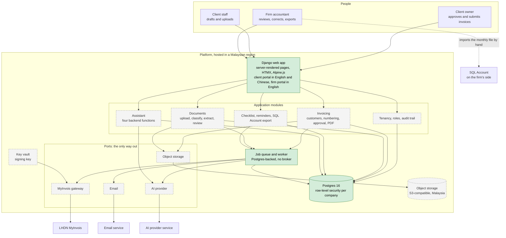
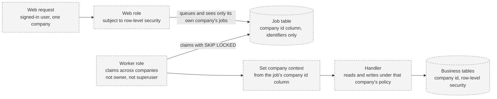
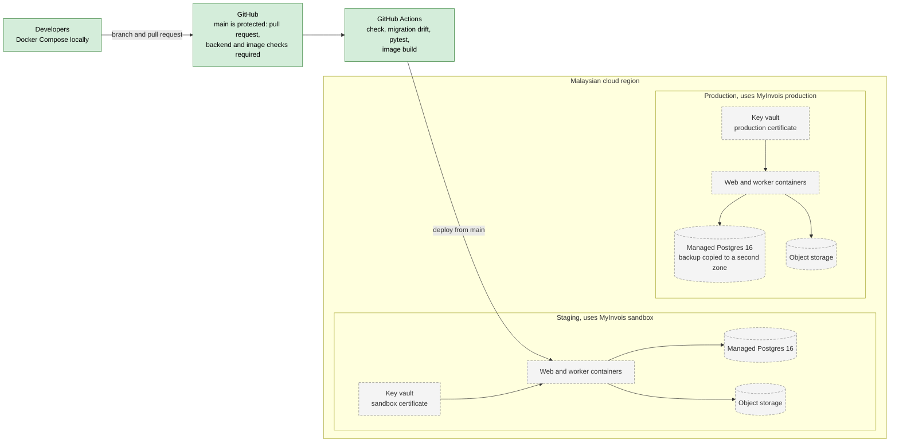

# Architecture

How the pilot platform is put together. Sources: `docs/product/pilot-spec.md`, the decision log (`docs/architecture/Decision/pilot-decisions.md`, D1 to D37) and ADR 0001 (`docs/adr/0001-job-queue-and-tenancy.md`). Data flows are in `data-flow.md`.

**Legend.** Solid green boxes exist on `main` today. Dashed grey boxes are planned and tracked in the GitHub issues named in the status table at the end. Nothing here is built that the table does not say is built.

## 1. System overview

Two portals in one Django application. Everything the application knows about the outside world goes through four ports, each a single module with a fake used in tests. Each client company's data is isolated inside Postgres.

What "built" means above: the Django app with a health page and a sign-in-only home page, the job queue, Postgres, and the port registry with fakes. The four real adapters and every business module are still to do.

## 2. Rules the shape depends on

| Rule | Where it comes from | What it forces |
|---|---|---|
| External services only through the four ports | Hard rule in `CLAUDE.md`, from the spec's "External ports" decision | Swapping the AI provider or MyInvois library never touches callers; tests use fakes |
| Every business table has a company id and row-level security | D11 | Isolation is enforced by the database, not only by queries in code |
| Jobs carry a company id and run under that company's context | D36, ADR 0001 | A worker role claims jobs across companies but sets the tenant context from the job's column, never its payload |
| Only the owner approves and submits | D17 | Staff and the assistant can only draft |
| The model never touches the database | D26 | The backend runs four functions on the model's behalf with the user's permissions |
| Signing key lives in a key vault | D13 | Only the signing code can read it, and every signing is logged |
| Database and files in Malaysia | D12 | Hosting region is a fixed choice; AI processing in-region is preferred, not required (D3) |

## 3. Database roles and trust boundary

The job table is the one place where the web side and the worker side meet (ADR 0001, D36). Two roles keep that safe.

Today the job table has no company id and no row-level security. That is acceptable only because no tenant data exists yet; the column, policy and roles arrive with ticket 02 (#3), and no handler may touch tenant data before then.

## 4. Deployment view (planned)

Sandbox and production use different signing certificates (D13). Staging and production both live in the Malaysian region (D12); the cloud provider is not yet chosen, AWS Malaysia being the working assumption.

## 5. Status

| Part | State | Tracked in |
|---|---|---|
| Django app, health page, translation, CI, image build | Built, on `main` | #2 (closed) |
| Port registry and fakes; Postgres-backed job queue with identifier-only payloads | Built, on `main` | #2 |
| Companies, roles, audit, row-level security, job company id and role split | Planned | #3 |
| MyInvois gateway and sandbox spike | Planned | #4 |
| Malaysian hosting, staging, key vault, backups, email domain | Planned | #5 |
| AI port and extraction harness | Planned | #6 |
| Invoicing, documents, review, export, checklist, assistant, onboarding | Planned | #7 to #24 |
| Job leases, retries, idempotent external calls | Planned | #27 |
