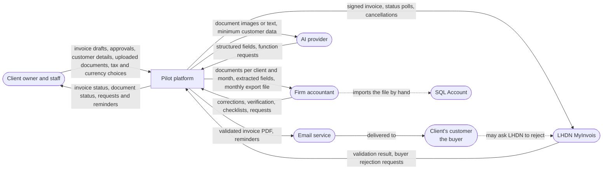
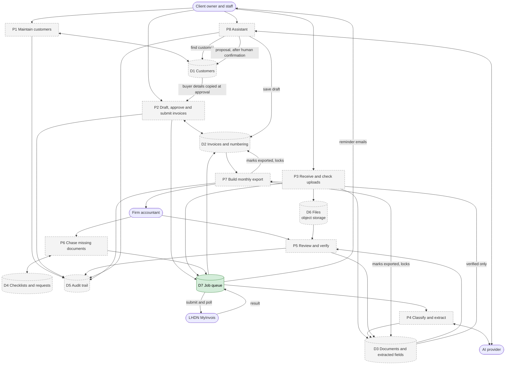
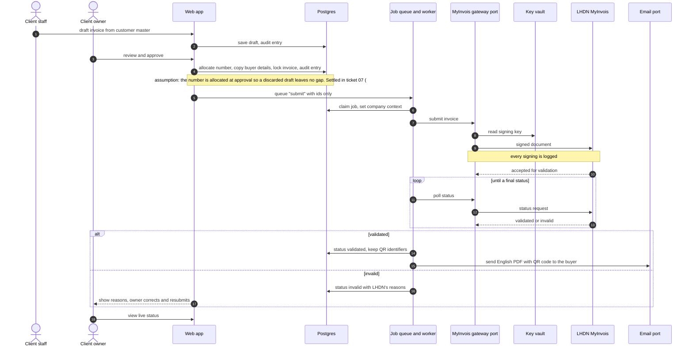
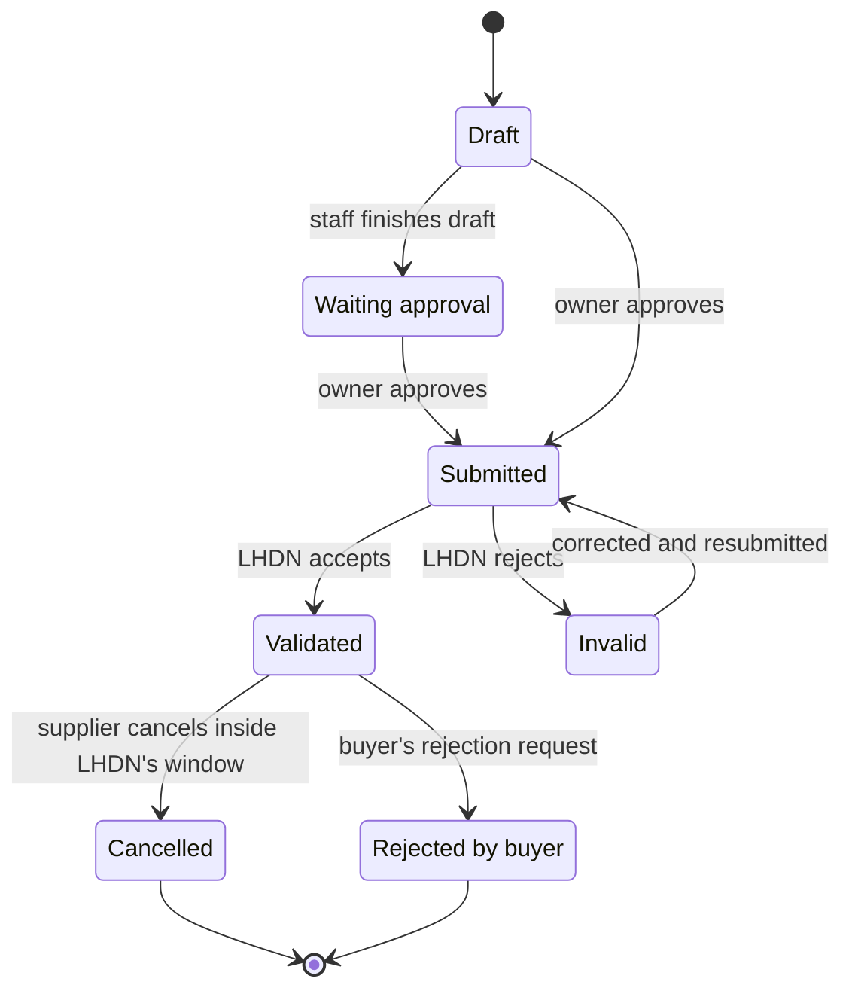
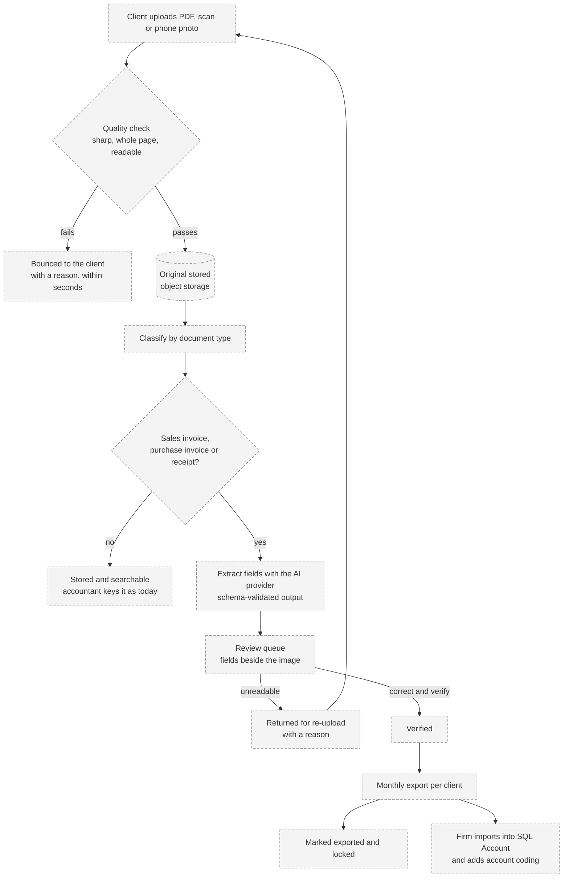
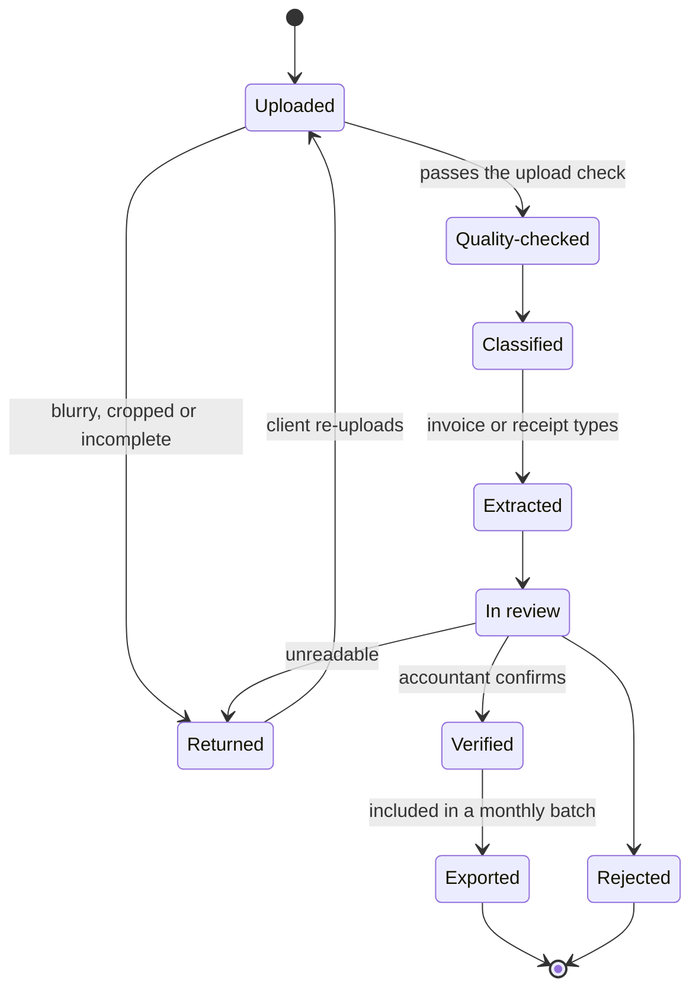
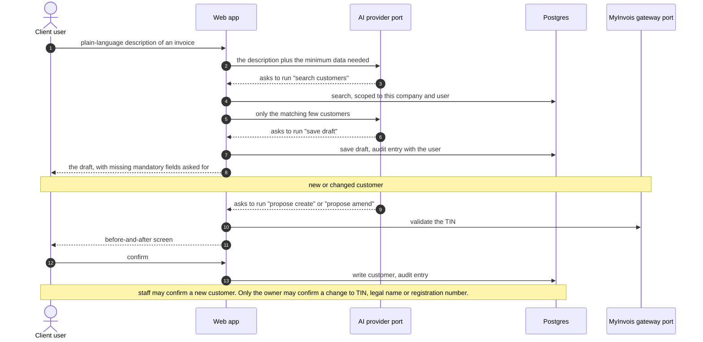
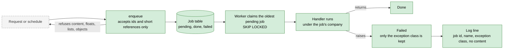

# Data flow

How data moves through the pilot platform. Sources: `docs/product/pilot-spec.md`, the decision log (D1 to D37) and ADR 0001. The structure is in `architecture.md`. Almost everything here is **planned**; only the job queue, the port registry with fakes, and the health and home pages exist on `main`.

Where the spec does not fix a detail, the diagram says "assumption" and names the ticket that settles it.

## 1. Level 0: the system and the outside world

## 2. Level 1: processes and data stores

Numbered processes (P), data stores (D). Every process runs inside one company's context; every store holds a company id and sits under row-level security, except the job table until ticket 02 gives it a company id (ADR 0001).

## 3. E-invoice: from draft to delivered

Only the owner approves and submits (D17). Approval locks a copy of the buyer details on the invoice (D19). The signing key is read only by the signing code (D13).

If LHDN is unavailable, the submit job waits in the queue and the owner sees a status banner (D16). Retries must not create a second invoice at LHDN; the lease and idempotency work for that is ticket #27.

### Invoice states

Credit, debit and refund notes follow the same path as separate documents that reference the original (ticket 10, #11).

## 4. Document: from upload to SQL Account

Only verified documents are exported, never twice (D21). A cancellation or correction after export is exported as a new item in the next batch, flagged "changed after export". Text inside a document is treated as data and never as an instruction to the model (D28).

### Document states

## 5. Assistant: what the model can and cannot do

The model has no database connection (D26). It sees only what the backend puts in the request, and it can only ask the backend to run four functions with the signed-in user's permissions (D27, D28).

Not available to the model, by design: delete a customer, approve or submit an invoice, choose a tax when uncertain.

## 6. Job queue

Built today: the enqueue check, the table, claiming, the identifier-only payload rule and the no-content failure record. Planned: the company id column and policy (ticket 02, #3); leases, retries, backoff, idempotent external calls and a purge of old jobs (#27).

## 7. What leaves the platform

| Data | Goes to | When | Control |
|---|---|---|---|
| Signed invoice | LHDN MyInvois | Owner approves | Signing key from the key vault; separate sandbox and production certificates; every signing logged (D13) |
| Document images or text | AI provider | After upload, for invoices and receipts | Client consent, a no-training data processing agreement, in-region preferred (D3); output schema-checked |
| Minimum customer data and the user's description | AI provider | When the assistant is used | Only matching customers are sent; the model has no database access (D26) |
| Validated invoice PDF | The client's customer, by email | After LHDN validates | Sent from the platform's domain under the client's name, with the client's reply-to (D23) |
| Reminders | The client, by email | Days 3, 7 and 14 after the due date | Stops after three and flags the accountant (D22) |
| Monthly export file | The firm accountant, who imports it by hand | Per client, per month | Verified documents only, never twice (D21) |
| Originals and database | Stay in the Malaysian region | Always | D12; daily backups copied to a second Malaysian zone |
